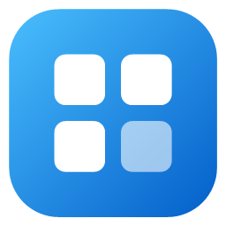
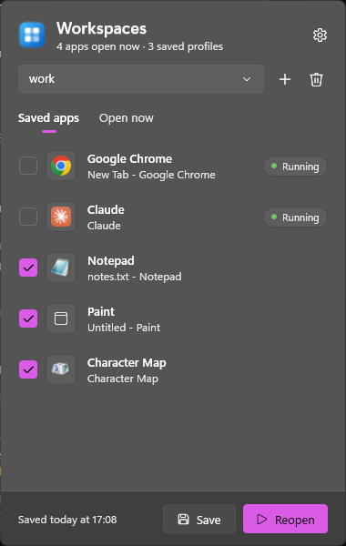
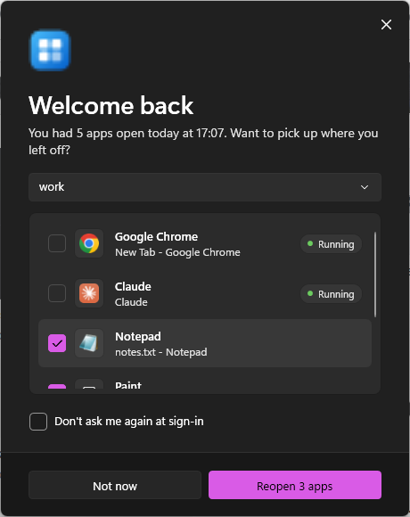

<div align="center">



# Workspace Manager

**Save the apps you have open. Get them back when you sign in.**

A lightweight Windows 11 tray app with a native Fluent look: acrylic flyout, Mica windows, rounded corners, your accent color, light and dark mode.


</div>

<table>
  <tr>
    <td align="center"><br /><sub><b>Tray flyout</b>: your saved apps, at a click</sub></td>
    <td align="center"><br /><sub><b>Sign-in prompt</b>: you decide, yes or no</sub></td>
  </tr>
</table>

---

## ✨ Features

| | |
|---|---|
| 🪟 **Tray flyout** | Left-click the tray icon for a Quick Settings–style panel. The **Saved apps** and **Open now** tabs show app icons and a live *Running* badge. |
| 👋 **Sign-in prompt** | After you sign in, a *Welcome back* window lists the apps from last time. Untick what you don't want, then **Reopen** or **Not now**. |
| 💾 **Profiles** | Keep as many workspaces as you like (*Work*, *Gaming*, *Study*…). Create, switch and delete them from the flyout. Deleted profiles go to the Recycle Bin. |
| 🔄 **Automatic "Last session"** | The current set of apps is remembered every 2 minutes and on shutdown, so the sign-in prompt always knows what you had open. |
| ⚡ **Smart restore** | Skips apps that are already running and reopens Store apps through their AppUserModelID. |
| 🖱️ **Right-click menu** | Save to or reopen any profile, toggle *Start with Windows*, exit. |
| 🎯 **Jump to window** | Double-click an app under *Open now* to bring its window to the front. |
| 🎨 **Native look** | Follows your Windows theme and accent color and updates live when you change them. |
| 🤖 **Claude Code integration** | Optional `/save-apps` and `/reopen-apps` slash commands that use the same profiles (see [below](#-claude-code-integration)). |

## 📦 Install

Requires **Windows 10 1809+ / Windows 11** and the **[.NET 10 SDK](https://dotnet.microsoft.com/download/dotnet/10.0)** to build. Mica and acrylic need Windows 11 22H2 or later; older versions get a solid background.

```powershell
git clone https://github.com/<you>/WorkspaceManager.git
cd WorkspaceManager
dotnet publish src/WorkspaceManager -c Release -o "$env:LOCALAPPDATA\Programs\WorkspaceManager"
& "$env:LOCALAPPDATA\Programs\WorkspaceManager\WorkspaceManager.exe"
```

On first run it adds itself to *Start with Windows*. Turn that off any time in ⚙️ Settings or the tray menu.

> **Tip:** Prebuilt zips are attached to every [release](../../releases). They need the .NET 10 Desktop Runtime.

## 🚀 Usage

1. **Open the apps you want** in a workspace.
2. Click the **tray icon**, choose a profile, then **Save**. Only the apps checked under *Open now* are saved.
3. Next time you sign in, Workspace Manager asks if you want them back. Choose **Reopen** or **Not now**.

Any time later: tray icon → pick a profile → **Reopen**.

### Settings

| Setting | Default | What it does |
|---|---|---|
| Start with Windows | On | Adds the app to `HKCU\…\Run` with `--startup`. |
| Ask to reopen apps at sign-in | On | Shows the *Welcome back* prompt. It only appears if something isn't already running. |
| Remember my apps automatically | On | Keeps the *Last session* profile current. |
| Profile to offer at sign-in | Last session | Falls back to *Default* if that profile is empty. |

## 🗂️ Where things live

| What | Where |
|---|---|
| App | `%LOCALAPPDATA%\Programs\WorkspaceManager\` |
| Profiles | `%USERPROFILE%\.claude\workspaces\<profile>.json` |
| Settings | `%APPDATA%\WorkspaceManager\settings.json` |
| Error log | `%APPDATA%\WorkspaceManager\error.log` |

<details>
<summary>Profile format</summary>

```json
{
  "Profile": "work",
  "SavedAt": "2026-11-16T17:35:50",
  "Apps": [
    {
      "Name": "chrome",
      "DisplayName": "Google Chrome",
      "Title": "New Tab - Google Chrome",
      "Path": "C:\\Program Files\\Google\\Chrome\\Application\\chrome.exe"
    }
  ]
}
```

`DisplayName` and `Aumid` (for Store apps) are optional.
</details>

## 🤖 Claude Code integration

[`claude-code/`](claude-code) contains a PowerShell script and two slash commands for [Claude Code](https://claude.com/claude-code). They read and write the same profiles as the app.

```powershell
New-Item -ItemType Directory -Force ~/.claude/scripts, ~/.claude/commands | Out-Null
Copy-Item claude-code/workspace.ps1 ~/.claude/scripts/
Copy-Item claude-code/commands/*.md ~/.claude/commands/
```

Then in Claude Code: `/save-apps work` and `/reopen-apps work`. The script also works on its own:

```powershell
powershell -ExecutionPolicy Bypass -File ~/.claude/scripts/workspace.ps1 save|restore|list [profile]
```

## 🛠️ How it works

- **Detecting apps:** enumerates top-level windows (`EnumWindows`) and keeps those that are visible, titled, unowned and not tool windows. Cloaked background Store windows, shell processes and anything under `C:\Windows` are dropped. Store apps hosted in `ApplicationFrameHost` are resolved to their real process.
- **Reopening:** `ShellExecute` on the saved `.exe`, or `shell:AppsFolder\<AUMID>` for packaged apps, with a short pause between launches.
- **UI:** WPF on .NET 10 with `ThemeMode="System"`. The backdrop is set via `DWMWA_SYSTEMBACKDROP_TYPE` (acrylic for the flyout, Mica for the prompt) plus `DWMWA_WINDOW_CORNER_PREFERENCE` for rounded corners.

```
src/WorkspaceManager/
├── App.xaml(.cs)            tray icon, menu, sign-in flow, autosave
├── FlyoutWindow.xaml(.cs)   tray flyout + settings
├── StartupPrompt.xaml(.cs)  "Welcome back" window
├── Workspace.cs             window enumeration, profiles, launching
├── Support.cs               settings, theme, Fluent window base, icons
├── Native.cs                Win32 / DWM interop
└── Styles.xaml              buttons, toggle switch, list items
```

## ⚠️ Limitations

- Reopens **programs, not their contents.** Browser tabs, documents and window positions aren't restored (most apps restore their own session).
- Apps that need **admin rights** are captured but will show a UAC prompt when reopened.
- Built-in Windows tools under `C:\Windows` (Explorer, Settings…) are skipped on purpose.

## 🔒 Security

Workspace Manager runs with normal user rights, needs no network access and collects no data. See [SECURITY.md](SECURITY.md) for the security review and how to report a vulnerability.

## 📄 License

[MIT](LICENSE)
